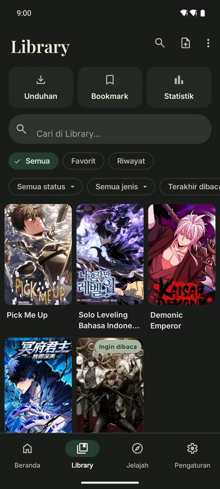
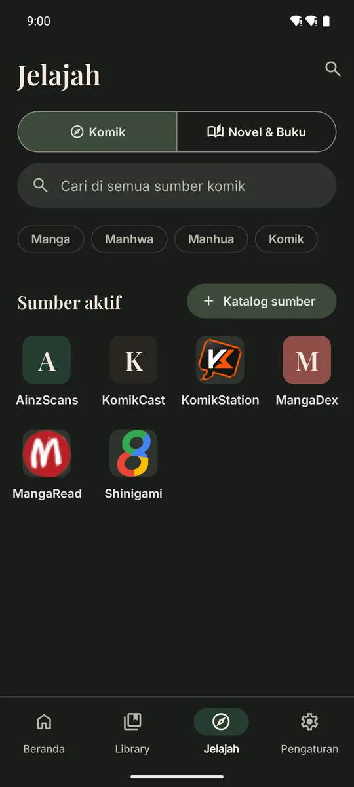
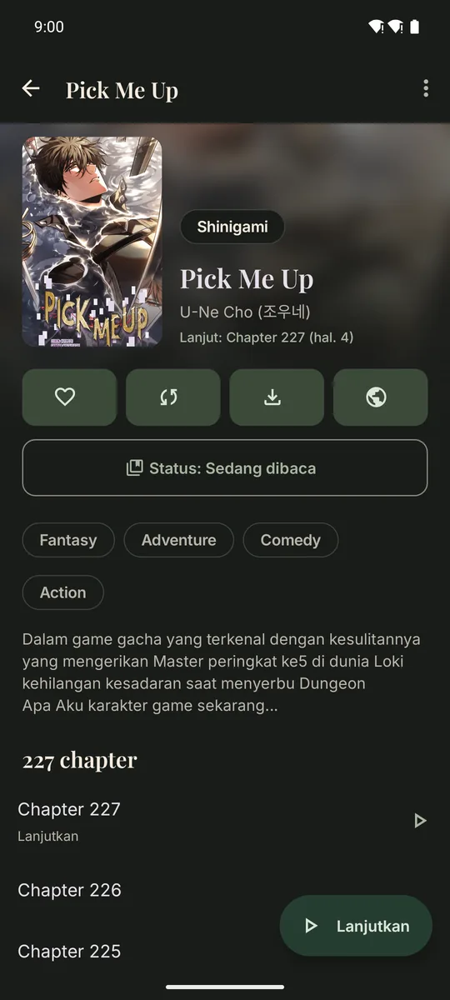
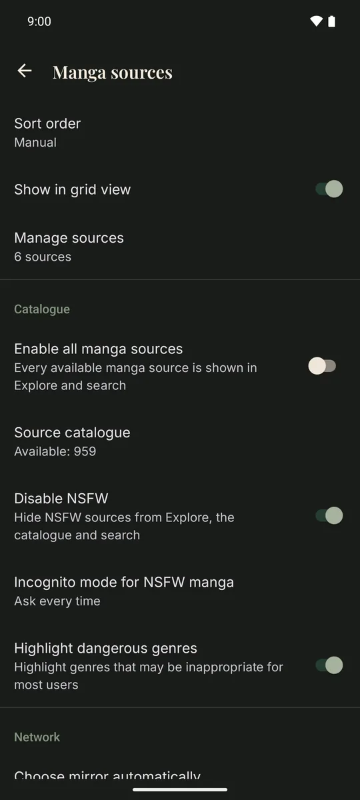
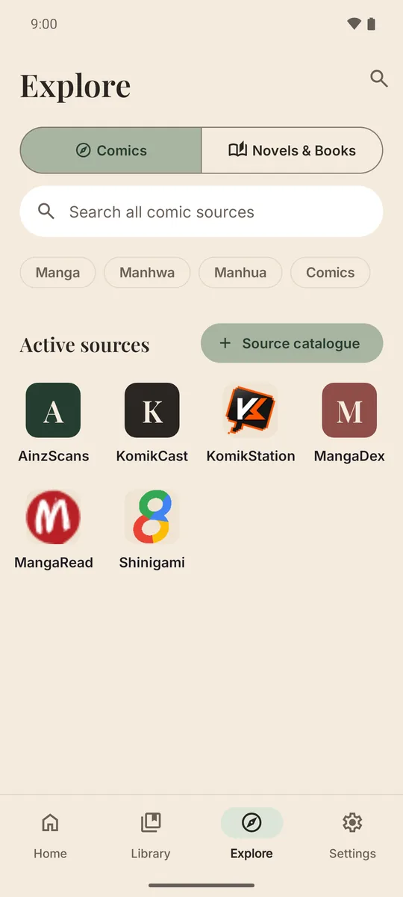
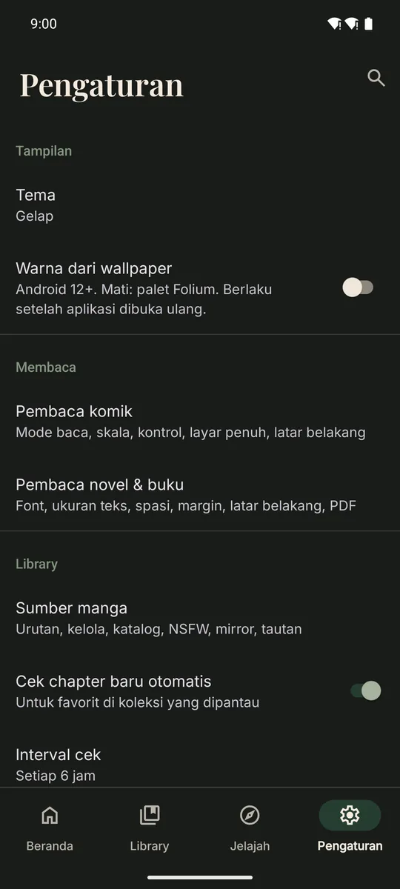

<div align="center">


# Folium

**Your Cozy Reading Space. A place for every story.**

Perpustakaan digital Android untuk komik, novel online, dan buku lokal dalam satu tempat.

-263D32?logo=android&logoColor=F5EBDD)


</div>

---

Folium menggabungkan manga, manhwa, manhua, novel web, PDF, dan EPUB ke dalam satu perpustakaan. Semuanya memakai progres, riwayat, dan koleksi yang sama.

Mesin sumbernya memakai **[kotatsu-parsers](https://github.com/KotatsuApp/kotatsu-parsers)**, dan pengalaman membaca komiknya mengikuti **[Kotatsu](https://github.com/KotatsuApp/Kotatsu)**. Di atasnya, Folium punya desain sendiri: tenang, hangat, dan nyaman untuk sesi baca yang panjang.

## Tangkapan layar

<table>
  <tr>
    <td align="center"><br /><sub>Beranda</sub></td>
    <td align="center"><br /><sub>Library</sub></td>
    <td align="center"><br /><sub>Jelajah</sub></td>
    <td align="center"><br /><sub>Detail judul</sub></td>
  </tr>
  <tr>
    <td align="center"><br /><sub>Pembaca komik</sub></td>
    <td align="center"><br /><sub>Pengaturan pembaca komik</sub></td>
    <td align="center"><br /><sub>Pembaca novel &amp; buku</sub></td>
    <td align="center"><br /><sub>Sumber manga</sub></td>
  </tr>
  <tr>
    <td align="center"><br /><sub>Tema terang</sub></td>
    <td align="center"><br /><sub>Jelajah (terang)</sub></td>
    <td align="center"><br /><sub>Pengaturan</sub></td>
    <td></td>
  </tr>
</table>

## Kapabilitas

### Satu perpustakaan untuk semua format

| Format | Sumber | Pembaca |
|---|---|---|
| Manga, manhwa, manhua, komik | 1.200+ situs lewat kotatsu-parsers, termasuk banyak sumber berbahasa Indonesia | Pembaca komik (gambar) |
| Novel web | WebNovel (bab gratis; bab berbayar hanya pratinjau publik) | Pembaca teks |
| EPUB | Impor file dari perangkat | Pembaca teks |
| PDF | Impor file dari perangkat | Pembaca halaman |

### Beranda dan Library

- **Beranda:** kartu "Lanjut membaca", rak riwayat, rekomendasi, dan daftar bab baru dari judul yang dipantau.
- **Library:** favorit, riwayat, dan status baca (Sedang dibaca, Ingin dibaca, Selesai, Ditunda, Berhenti).
  - Koleksi buatan sendiri.
  - Filter per status dan jenis, urutan, dan pencarian di dalam Library.
  - Progres baca tampil di setiap judul.
- **Unduhan, bookmark, dan statistik** waktu baca per judul.
- **Pelacak bab baru** di latar belakang dengan notifikasi untuk koleksi yang dipantau.
- **Backup dan restore** dalam satu file JSON: favorit, koleksi, riwayat, bookmark, status, dan domain.

### Jelajah dan sumber

- **Dua ruang terpisah:** Komik serta Novel & Buku. Masing-masing punya sumber, pencarian global, dan katalognya sendiri.
- **Katalog sumber:** filter bahasa dan tipe, favicon, dan penanda sumber rusak. Kalau sumber gagal dibuka, situsnya bisa dibuka di browser bawaan, misalnya untuk verifikasi Cloudflare.
- **Pengaturan → Sumber manga** (mengikuti Kotatsu):
  - urutan manual, alfabetis, atau terakhir digunakan;
  - tampilan kisi;
  - kelola sumber (tahan dan geser untuk mengurutkan);
  - aktifkan semua sumber;
  - nonaktifkan NSFW, dan mode penyamaran untuk judul NSFW;
  - tandai genre berbahaya;
  - pilih mirror otomatis;
  - tangani tautan: link manga dari browser dibuka langsung di Folium.
- **Pengaturan per sumber:** aktif/nonaktif, domain dan mirror, User-Agent, server gambar, konten mencurigakan, pemisahan terjemahan, perlambat unduhan, login ke situs, hapus cookie, buka di browser.

### Pembaca komik

- **Mode:** Standar (kiri ke kanan), Kanan-ke-kiri, Vertikal, dan Webtoon. Mode diingat per judul, dan webtoon bisa terdeteksi otomatis.
- **Mode skala:** pas tengah, pas tinggi, pas lebar, atau tetap di awal.
- **Zoom:** cubit atau ketuk dua kali, dengan geser dalam gambar yang diperbesar.
- **Kontrol:** zona ketuk, tombol volume (bisa dibalik), tombol panah keyboard, dan kontrol ergonomis.
- **Tampilan:** animasi halaman, layar penuh, orientasi, bilah informasi, latar belakang, kecerahan, dan layar tetap menyala.
- **Membaca:** lanjut otomatis ke bab berikutnya, popup judul bab, halaman dimuat lebih awal (selalu atau hanya di Wi-Fi), bookmark halaman, dan baca offline dari unduhan.

### Pembaca novel dan buku

- **Teks:** font serif atau sans, ukuran teks, spasi baris, margin, latar (kertas, putih, abu, hitam), dan kecerahan. Pengaturannya terpisah dari pembaca komik.
- **Novel web:** navigasi bab, posisi gulir diingat, dan unduhan bab untuk dibaca offline.
- **EPUB:** daftar isi, sampul, dan posisi di dalam bab yang tersimpan.
- **PDF:** mode gulir atau per halaman.

### Lainnya

- **Scrobbling:** AniList, MyAnimeList, Kitsu, dan Shikimori.
- **Tema:** terang, gelap, atau ikut sistem, plus warna dinamis dari wallpaper (Android 12+).
- **Desain:** Playfair Display untuk judul, Inter untuk teks, palet hijau hutan, krem, dan sage dengan kontras yang dicek, dan ikon Material Symbols.

## Teknologi

- **Kotlin**, Android Views + ViewBinding, dan **Material 3**.
- **Room** (dengan migrasi yang dites), **WorkManager**, **OkHttp**, **Jsoup**, dan **Coil**.
- **kotatsu-parsers** untuk sumber manga, dengan adaptor sendiri untuk konteks jaringan, cookie WebView, dan verifikasi Cloudflare.
- Tanpa framework DI. Dependensi dirakit di `App.kt`.

```
app/src/main/java/dev/mangareader/
├── data/         Room, repository, Library, backup, penyimpanan unduhan
├── document/     EPUB/PDF lokal
├── parser/       adaptor kotatsu-parsers, WebView fetcher, sumber novel
├── scrobbling/   AniList, MAL, Kitsu, Shikimori
├── ui/           activity, fragment, pembaca, pengaturan
└── work/         unduhan dan pelacak bab baru
```

## Build

Butuh JDK 17+ dan Android SDK (compileSdk 36).

```bash
./gradlew :app:assembleDebug      # APK di app/build/outputs/apk/debug/
./gradlew :app:testDebugUnitTest  # unit test
./gradlew :app:lintDebug          # lint
```

Tes migrasi database ada di `app/src/androidTest`. Jangan jalankan lewat `connectedAndroidTest` di perangkat yang berisi data penting, karena Gradle meng-uninstall aplikasi sesudahnya. Cara yang aman ada di [`docs/FOLIUM_IMPLEMENTATION_PLAN.md`](docs/FOLIUM_IMPLEMENTATION_PLAN.md), bagian Fase 6.

Dokumentasi produk, arsitektur, dan rencana implementasi ada di [`docs/`](docs/).

## Kredit

Folium berdiri di atas karya **[Kotatsu](https://github.com/KotatsuApp/Kotatsu)** oleh Koitharu dan para kontributornya (GPL-3.0):

- Semua sumber manga memakai **[kotatsu-parsers](https://github.com/KotatsuApp/kotatsu-parsers)** (GPL-3.0) lewat JitPack.
- Pengaturan pembaca, pengaturan sumber, katalog sumber, dan pemilihan mirror mengikuti Kotatsu, dengan kunci pengaturan dan label yang sama. Sebagian logikanya diadaptasi dari kode Kotatsu.

Folium bukan proyek resmi Kotatsu dan tidak berafiliasi dengannya.

Aset pihak ketiga:

- Font [Playfair Display](https://github.com/clauseggers/Playfair) dan [Inter](https://github.com/rsms/inter), keduanya SIL Open Font License 1.1. Teks lisensinya ada di `app/src/main/assets/`.
- Ikon [Material Symbols](https://github.com/google/material-design-icons) (Apache-2.0).

## Penafian

Folium tidak meng-host, mengunggah, atau mendistribusikan konten apa pun. Semua manga dan novel dimuat langsung dari situs sumbernya, dan hak cipta tetap milik pemiliknya masing-masing. Gambar sampul dan halaman di tangkapan layar hanya untuk menunjukkan antarmuka.

## Lisensi

[GNU General Public License v3.0](LICENSE), mengikuti lisensi Kotatsu dan kotatsu-parsers.
