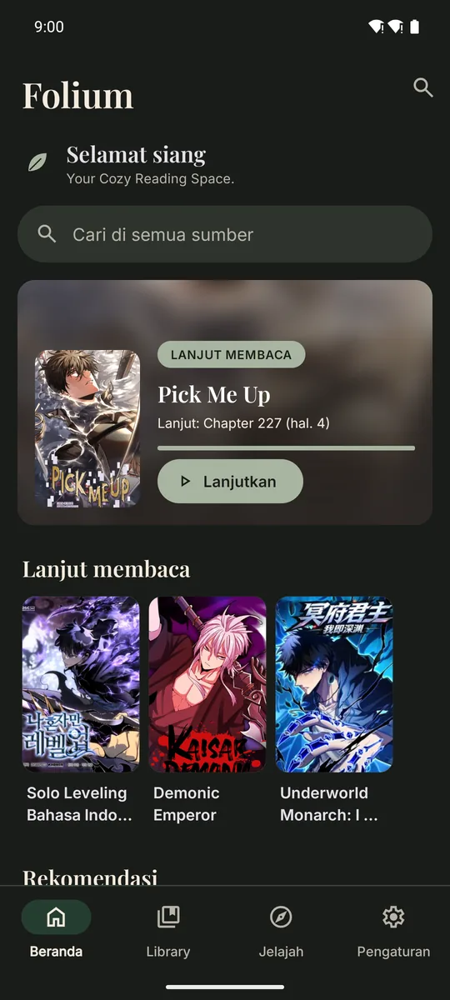
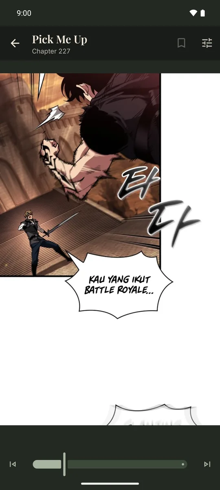
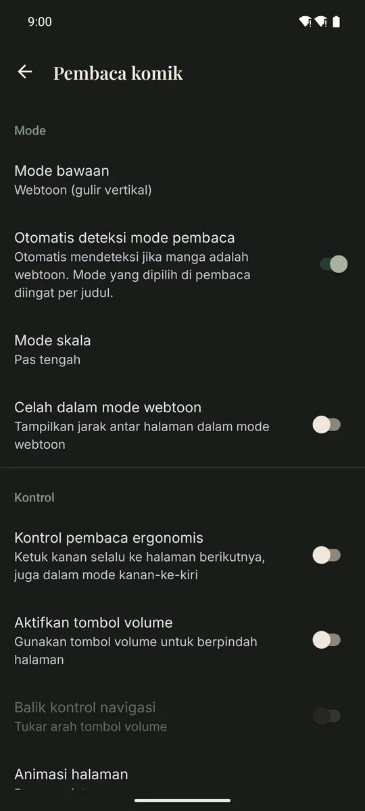
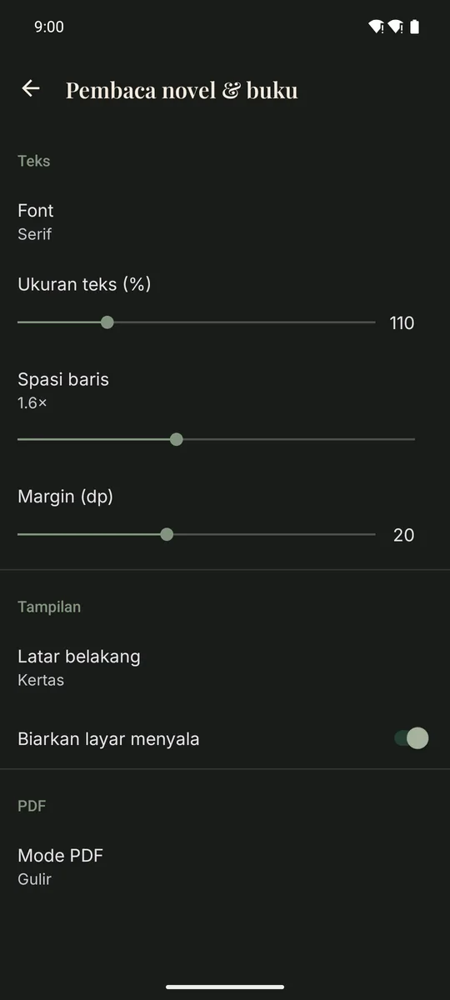
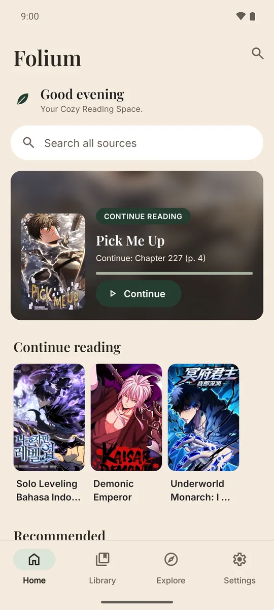

<div align="center">


# Folium

**Your Cozy Reading Space. A place for every story.**

An Android digital library for comics, web novels, and local books in one place.

-263D32?logo=android&logoColor=F5EBDD)


</div>

---

Folium brings manga, manhwa, manhua, web novels, PDFs, and EPUBs together in one library. Every format shares the same progress, history, and collections.

Sources are powered by **[kotatsu-parsers](https://github.com/KotatsuApp/kotatsu-parsers)**, and the comic reading experience follows **[Kotatsu](https://github.com/KotatsuApp/Kotatsu)**. On top of that, Folium has a design of its own: calm, warm, and comfortable for long reading sessions.

> Available in **English** (default) and **Bahasa Indonesia**. Change it in Settings → Language, or in Android 13+ system settings.

## Screenshots

<table>
  <tr>
    <td align="center"><br /><sub>Home</sub></td>
    <td align="center"><br /><sub>Library</sub></td>
    <td align="center"><br /><sub>Explore</sub></td>
    <td align="center"><br /><sub>Title details</sub></td>
  </tr>
  <tr>
    <td align="center"><br /><sub>Comic reader</sub></td>
    <td align="center"><br /><sub>Comic reader settings</sub></td>
    <td align="center"><br /><sub>Novel &amp; book reader</sub></td>
    <td align="center"><br /><sub>Manga sources</sub></td>
  </tr>
  <tr>
    <td align="center"><br /><sub>Light theme</sub></td>
    <td align="center"><br /><sub>Explore (light)</sub></td>
    <td align="center"><br /><sub>Settings</sub></td>
    <td></td>
  </tr>
</table>

## Features

### One library for every format

| Format | Source | Reader |
|---|---|---|
| Manga, manhwa, manhua, comics | 1,200+ sites via kotatsu-parsers, including many Indonesian sources | Comic (image) reader |
| Web novels | WebNovel (free chapters; paid chapters show only the public preview) | Text reader |
| EPUB | Imported from the device | Text reader |
| PDF | Imported from the device | Page reader |

### Home and Library

- **Home:** a "Continue reading" card, a history shelf, recommendations, and new chapters from followed titles.
- **Library:** favourites, history, and reading statuses (Reading, Want to read, Completed, On hold, Dropped).
  - Custom collections.
  - Filters by status and type, sorting, and search within the Library.
  - Reading progress shown on every title.
- **Downloads, bookmarks, and reading-time statistics** per title.
- **Background new-chapter tracker** with notifications for followed collections.
- **Backup and restore** in a single JSON file: favourites, collections, history, bookmarks, statuses, and domains.

### Explore and sources

- **Two separate spaces:** Comics, and Novels & Books. Each has its own sources, global search, and catalogue.
- **Source catalogue:** language and type filters, favicons, and broken-source markers. When a source fails to load, its site can be opened in the built-in browser, for example to pass a Cloudflare check.
- **Settings → Manga sources** (as in Kotatsu):
  - manual, alphabetical, or last-used order;
  - grid view;
  - manage sources (press and drag to reorder);
  - enable all sources;
  - disable NSFW, and incognito mode for NSFW titles;
  - highlight dangerous genres;
  - automatic mirror selection;
  - link handling: manga links from the browser open directly in Folium.
- **Per-source settings:** enable/disable, domain and mirrors, User-Agent, image server, suspicious content, split by translation, download slowdown, sign in to the site, clear cookies, open in browser.

### Comic reader

- **Modes:** Standard (left to right), Right to left, Vertical, and Webtoon. The mode is remembered per title, and webtoons can be detected automatically.
- **Scale modes:** fit center, fit height, fit width, or keep at start.
- **Zoom:** pinch or double-tap, with panning inside the zoomed image.
- **Controls:** tap zones, volume keys (invertible), keyboard arrow keys, and ergonomic controls.
- **Display:** page animation, fullscreen, orientation, info bar, background, brightness, and keep screen on.
- **Reading:** auto-advance to the next chapter, chapter-change popup, page preloading (always or Wi-Fi only), page bookmarks, and offline reading from downloads.

### Novel and book reader

- **Text:** serif or sans font, text size, line spacing, margins, background (paper, white, grey, black), and brightness. These settings are separate from the comic reader.
- **Web novels:** chapter navigation, remembered scroll position, and chapter downloads for offline reading.
- **EPUB:** table of contents, cover, and saved position inside a chapter.
- **PDF:** scroll or page-by-page mode.

### More

- **Scrobbling:** AniList, MyAnimeList, Kitsu, and Shikimori.
- **Languages:** English (default) and Bahasa Indonesia, switchable in the app; on Android 13+ also from the system's per-app language settings.
- **Themes:** light, dark, or follow the system, plus dynamic wallpaper colours (Android 12+).
- **Design:** Playfair Display for headings, Inter for text, a forest-green, cream, and sage palette with contrast-checked colours, and Material Symbols icons.

## Tech stack

- **Kotlin**, Android Views + ViewBinding, and **Material 3**.
- **Room** (with tested migrations), **WorkManager**, **OkHttp**, **Jsoup**, and **Coil**.
- **kotatsu-parsers** for manga sources, with Folium's own adapter for networking, WebView cookies, and Cloudflare checks.
- No DI framework. Dependencies are wired up in `App.kt`.

```
app/src/main/java/dev/mangareader/
├── data/         Room, repository, Library, backup, download storage
├── document/     local EPUB/PDF
├── parser/       kotatsu-parsers adapter, WebView fetcher, novel source
├── scrobbling/   AniList, MAL, Kitsu, Shikimori
├── ui/           activities, fragments, readers, settings
└── work/         downloads and new-chapter tracker
```

## Building

Requires JDK 17+ and the Android SDK (compileSdk 36).

```bash
./gradlew :app:assembleDebug      # APK in app/build/outputs/apk/debug/
./gradlew :app:testDebugUnitTest  # unit tests
./gradlew :app:lintDebug          # lint
```

The database migration test lives in `app/src/androidTest`. Don't run it with `connectedAndroidTest` on a device that holds data you care about: Gradle uninstalls the app afterwards. The safe way to run it is described in [`docs/FOLIUM_IMPLEMENTATION_PLAN.md`](docs/FOLIUM_IMPLEMENTATION_PLAN.md), under Phase 6.

Product, architecture, and implementation-plan documents (in Indonesian) are in [`docs/`](docs/).

## Credits

Folium is built on the work of **[Kotatsu](https://github.com/KotatsuApp/Kotatsu)** by Koitharu and its contributors (GPL-3.0):

- All manga sources come from **[kotatsu-parsers](https://github.com/KotatsuApp/kotatsu-parsers)** (GPL-3.0), via JitPack.
- Reader settings, source settings, the source catalogue, and mirror selection follow Kotatsu, using the same setting keys and labels. Some of the logic is adapted from Kotatsu's code.

Folium is not an official Kotatsu project and is not affiliated with it.

Third-party assets:

- [Playfair Display](https://github.com/clauseggers/Playfair) and [Inter](https://github.com/rsms/inter) fonts, both under the SIL Open Font License 1.1. Their license texts are in `app/src/main/assets/`.
- [Material Symbols](https://github.com/google/material-design-icons) icons (Apache-2.0).

## Disclaimer

Folium does not host, upload, or distribute any content. All manga and novels are loaded directly from their source sites, and copyright remains with the respective owners. Covers and pages in the screenshots are shown only to demonstrate the interface.

## License

[GNU General Public License v3.0](LICENSE), following the license of Kotatsu and kotatsu-parsers.
